# InterviewSetu: Full Architecture & System Design Specification

This document provides a comprehensive, end-to-end technical specification of the **InterviewSetu** platform. It details the system architecture, frontend and backend implementations, programming languages, code formatting conventions, data models, workflows, and API specifications.

---

## 1. System Overview & Product Vision

**InterviewSetu** is a full-stack, multi-role interview preparation platform and verified mentor marketplace tailored for Indian competitive examinations and technical careers. It bridges the gap between academic preparation and real-world panel expectations through a two-pillar strategy:

1. **AI Practice Studio**: Adaptive, real-time mock interviews with voice and text synthesis, probe follow-up questions, and 5-dimension rubric scorecards.
2. **Human Mentor Marketplace**: 1:1 mock interviews conducted by verified ex-panelists, civil service rankers, and senior industry practitioners.
3. **Platform Trust & Compliance**: Comprehensive administrative operations console with interviewer credential verification, syllabus taxonomy management, and an immutable audit ledger.

### Core User Personas & Portals

| Persona | Primary Goal | Key Routes / Workspace |
|---|---|---|
| **Candidate (Aspirant)** | Practice AI interviews, study frameworks, book 1:1 human mentors, track readiness score. | `/app/candidate`, `/question-bank`, `/learn`, `/mentors` |
| **Interviewer (Mentor)** | Host mock sessions, evaluate candidates using standardized rubrics, manage availability slots, earn fees. | `/app/interviewer`, `/onboarding/interviewer` |
| **Platform Admin (Staff)** | Verify interviewer credentials, audit transactions, oversee AI rubrics, manage exam stages. | `/app/admin`, `/staff` |

---

## 2. Technology Stack & Languages

### Languages & Runtime
- **TypeScript 5.x**: Strictly typed across all layers (Frontend UI, API Route Handlers, Domain Services, and Data Models).
- **Node.js 20+**: Execution runtime supporting Next.js server actions, server components, and route handlers.
- **HTML5 & CSS3 / Modern Web APIs**: Web Speech API (`SpeechRecognition`, `SpeechSynthesis`), Web Audio API, WebRTC media streams.

### Frontend Stack (FE)
- **Framework**: **Next.js 15+ (App Router)** utilizing React 19 Server Components and Client Components.
- **Styling Engine**: **Tailwind CSS v4** configured with the custom **Signal & Flow (Liquid Aurora)** design tokens.
- **Design Language**:
  - Primary Aurora Palette: Indigo (`#6366f1` / `#4f46e5`), Violet (`#7c3aed`), Electric Cyan (`#06b6d4`), Emerald (`#10b981`), and Rose (`#f43f5e`).
  - Glassmorphic panels with backdrop filters (`backdrop-blur-xl`, `border-white/20`, `bg-white/80`).
  - Ripple micro-interactions (`RippleButton.tsx`) based on canvas/water physics.
- **Icons**: Accessible inline SVGs and Lucide-compatible semantic iconography.

### Backend Stack (BE)
- **API Architecture**: Next.js Route Handlers (`src/app/api/v1/*`) returning typed RESTful JSON responses.
- **Domain Service Layer**: `src/lib/services/interviewsetu-service.ts` encapsulates business logic, state machines, validation rules, and transactional transitions.
- **Persistence & CMS Layer**:
  - **In-Memory Domain Database (`src/lib/data/mock-db.ts`)**: Relational, multi-entity durable in-memory store pre-seeded with candidates, verified mentors, mock sessions, audit entries, question prompts, and lessons.
  - **Payload CMS 3.x**: Integrated via `@payloadcms/figma` for editorial content, asset storage, and administrator user credentials.
- **Media Engine Readiness**: Native support for WebRTC peer connections and LiveKit server tokens for 1:1 audio/video sessions.

---

## 3. High-Level System Architecture Diagram

```mermaid
graph TB
    subgraph "Client Layer (Next.js 15 App Router)"
        PublicPages["Public Pages (/ , /pricing, /exams)"]
        CandidateUI["Candidate Workspace (/app/candidate)"]
        InterviewerUI["Interviewer Workspace (/app/interviewer)"]
        AdminUI["Admin & Staff Console (/app/admin, /staff)"]
        RoleSwitcher["Global Multi-Role Switcher"]
    end

    subgraph "Edge / API Routing Layer (Next.js /api/v1)"
        AuthRouter["Session & Auth Endpoints (/api/v1/auth)"]
        TrackRouter["Tracks & Stage Taxonomy (/api/v1/tracks)"]
        QuestionRouter["Question Bank API (/api/v1/questions)"]
        LearnRouter["Learning Academy API (/api/v1/learning)"]
        MentorRouter["Mentors & Booking Engine (/api/v1/mentors, /api/v1/bookings)"]
        AIRouter["AI Interview Engine (/api/v1/interviews)"]
        AdminRouter["Staff Governance & Audit (/api/v1/admin)"]
    end

    subgraph "Domain Service Layer (src/lib/services)"
        Service["InterviewSetu Domain Service"]
        AIRubric["AI Adaptive Evaluator & Probe Generator"]
        BookingSM["Booking State Machine"]
        VerificationSM["Interviewer Verification State Machine"]
        AuditLedger["Immutable Audit Logger"]
    end

    subgraph "Data & Persistence Layer"
        DomainDB[("Domain Database (mock-db.ts / Relational)")]
        PayloadCMS[("Payload CMS (Admins, Media, Uploads)")]
    end

    ClientLayer --> EdgeAPILayer
    PublicPages --> TrackRouter & QuestionRouter & LearnRouter & MentorRouter
    CandidateUI --> AIRouter & MentorRouter & QuestionRouter
    InterviewerUI --> MentorRouter & BookingSM
    AdminUI --> AdminRouter
    RoleSwitcher --> PublicPages & CandidateUI & InterviewerUI & AdminUI

    EdgeAPILayer --> Service
    Service --> AIRubric & BookingSM & VerificationSM & AuditLedger
    Service --> DomainDB & PayloadCMS
```



---

## 4. Frontend Architecture (FE)

### 4.1 Route Groups & Directory Layout
```
src/app/(frontend)/
├── layout.tsx                     # Root HTML layout with fonts, navigation, and footer
├── page.tsx                       # Homepage (Liquid Aurora hero, waveform, tracks, FAQ)
├── styles.css                     # Global styles, Tailwind v4 imports, contrast rules
├── (public marketing pages)
│   ├── about/page.tsx             # Mission, pedagogy, and panel advisory
│   ├── contact/page.tsx           # Contact form and support routing
│   ├── exams/page.tsx             # Official exams directory (UPSC, Banking, MBA)
│   ├── exams/[slug]/page.tsx      # Exam stage breakdown and syllabus details
│   ├── for-colleges/page.tsx      # Institutional placement cell partnership
│   ├── interview-tracks/page.tsx  # Track directory (SWE, UPSC, Product, etc.)
│   ├── interview-tracks/[slug]/   # Track syllabus, competencies, and verified mentors
│   ├── learn/page.tsx             # Learning Academy course catalog
│   ├── learn/[slug]/page.tsx      # Interactive lesson reader and knowledge quiz
│   ├── mentors/page.tsx           # Mentor marketplace directory with filters
│   ├── mentors/[mentorSlug]/      # Mentor profile, reviews, and slot booking
│   ├── pricing/page.tsx           # Transparent plans and pay-as-you-go pricing
│   ├── question-bank/page.tsx     # Curated question prompts with STAR frameworks
│   ├── question-bank/[id]/        # Question deep dive, pitfalls, sample answers
│   └── register/ & login/         # Unified entry points for all three user roles
├── onboarding/
│   ├── candidate/page.tsx         # 6-step candidate profiling and goal setup
│   └── interviewer/page.tsx       # Credential verification & document upload
└── app/
    ├── candidate/page.tsx         # Full candidate studio (voice/text AI mock, history)
    ├── interviewer/page.tsx       # Interviewer cockpit (bookings, live room, scorecards)
    └── admin/page.tsx             # Platform governance, verification queue, audit logs
```

### 4.2 Core Components & Design System
- **`PublicNav.tsx`**: Top navigation with glassmorphism, responsive mobile drawer, route highlights, and one-click role preview modals.
- **`PublicFooter.tsx`**: Comprehensive sitemap, operational system health indicators, and legal notices.
- **`RoleSwitcher.tsx`**: Floating bottom-right widget allowing instant switching between Candidate, Interviewer, and Admin sessions with live visual badges.
- **`RippleButton.tsx`**: Physics-based interactive button with water ripple animation, high-contrast states (`primary`, `secondary`, `quiet`, `danger`, `ghost`).
- **Global CSS Contrast Rules (`styles.css`)**:
  - Excludes anchor tags with explicit color utilities from broad inheritance (`a:not([class*="text-"]):not([class*="btn"])`).
  - Forces high-contrast readability via `.text-white { color: #ffffff !important; }`.

---

## 5. Backend Architecture (BE)

### 5.1 Route Handlers (`/api/v1/*`)
All endpoints follow standard REST conventions, support strict HTTP methods, accept and emit `application/json`, and provide clear error messages.

| Method | Endpoint | Description | Request / Query Params |
|---|---|---|---|
| `GET` | `/api/v1/health` | Service health, adapter statuses, timestamp | None |
| `GET` | `/api/v1/tracks` | List interview preparation tracks | `?category=engineering` |
| `GET` | `/api/v1/tracks/[slug]` | Get specific track with stages and mentors | `slug` path param |
| `GET` | `/api/v1/questions` | Filter question bank prompts | `?trackSlug=...&difficulty=...` |
| `GET` | `/api/v1/questions/[id]` | Get question intent, STAR guide, sample answer | `id` path param |
| `POST` | `/api/v1/questions/[id]` | Toggle bookmark / saved status | `id` path param |
| `GET` | `/api/v1/learning/lessons` | List learning modules and framework courses | `?category=...` |
| `GET` | `/api/v1/learning/lessons/[slug]` | Get lesson text, framework steps, quiz | `slug` path param |
| `POST` | `/api/v1/learning/lessons/[slug]` | Record lesson completion and quiz score | `{ completed: boolean, score: number }` |
| `GET` | `/api/v1/mentors` | Filter verified mentors by domain & rate | `?domain=...&search=...` |
| `GET` | `/api/v1/mentors/[id]` | Mentor bio, credentials, available slots | `id` path param |
| `POST` | `/api/v1/bookings` | Book a 1:1 mentor slot | `{ mentorId, slot, candidateBrief, trackSlug }` |
| `PATCH`| `/api/v1/bookings/[id]` | Update booking state or submit scorecard | `{ action: 'confirm'\|'cancel'\|'scorecard', ... }` |
| `POST` | `/api/v1/interviews/session` | Start an adaptive AI mock session | `{ trackSlug, topic, difficulty, format }` |
| `POST` | `/api/v1/interviews/turn` | Submit spoken/typed answer turn | `{ sessionId, candidateResponse, turnIndex }` |
| `GET` | `/api/v1/interviews/[id]/report` | Generate/fetch multi-rubric scorecard | `id` session param |
| `GET` | `/api/v1/admin/overview` | Platform KPI stats and activity volume | None |
| `GET` | `/api/v1/admin/verification` | Queue of pending mentor applications | `?status=pending` |
| `POST` | `/api/v1/admin/verification` | Approve/reject mentor credential with reason | `{ mentorId, action, reason }` |
| `GET` | `/api/v1/admin/audit-logs` | Immutable audit log trail | `?limit=50` |

---

## 6. How Things Work: End-to-End Workflows

### 6.1 Workflow 1: AI Practice Studio Session
1. **Initiation**: The candidate selects a track (e.g. *Software Engineering*), difficulty level, and practice topic. The client calls `POST /api/v1/interviews/session`.
2. **Session Context**: The AI engine initializes a structured interview state with targeted competencies (e.g., *System Design*, *STAR behavioral*, *Coding trade-offs*).
3. **Turn-by-Turn Interaction**:
   - The candidate speaks (using Web Speech API speech recognition) or types their answer.
   - The response is sent via `POST /api/v1/interviews/turn`.
   - The engine analyzes the response against the STAR framework, identifies gaps (e.g., lack of measurable metrics or failure to state alternatives), and synthesizes an adaptive follow-up probe.
4. **Final Rubric Evaluation**:
   - Upon session completion, `GET /api/v1/interviews/[id]/report` generates a comprehensive scorecard across 5 dimensions:
     - Structure & Framework Adherence (STAR / PREP)
     - Technical Depth & Correctness
     - Communication Clarity & Conciseness
     - Handling of Follow-up Probes
     - Professional Presence & Composure
   - Actionable recommendations and model answer comparisons are saved to the candidate's persistent history.

### 6.2 Workflow 2: 1:1 Human Mentor Marketplace
1. **Discovery**: Candidate browses `/mentors`, filtering by domain (e.g. *Civil Services*, *Tech*, *MBA*), hourly rate, and language.
2. **Profile & Slot Selection**: Candidate visits `/mentors/[mentorSlug]`, inspects verified credentials (e.g., *Cleared UPSC 2021 with Rank 94*), selects an available IST time slot, and inputs a session brief.
3. **Booking Hold**: `POST /api/v1/bookings` reserves the slot in the domain database, records the preparation brief, and transitions status to `confirmed`.
4. **Live Session & Video Room**:
   - Both candidate and interviewer access the room link at the scheduled time.
   - The interviewer cockpit (`/app/interviewer`) displays candidate notes and structured evaluation forms alongside the video window.
5. **Post-Session Scorecard & Earnings**:
   - The mentor submits a structured scorecard via `PATCH /api/v1/bookings/[id]`.
   - Earnings are credited to the mentor's ledger balance.

### 6.3 Workflow 3: Mentor Verification & Trust Governance
1. **Application Submission**: Prospective interviewers fill out the multi-step verification form (`/onboarding/interviewer`), supplying identity details, employer/rank proof, and sample evaluation notes.
2. **Admin Review Queue**: Applications appear in `/app/admin` under the Verification Queue.
3. **Verification Action**: Platform administrators inspect claimed credentials and audit evidence files.
4. **Decision & Audit Entry**:
   - The admin calls `POST /api/v1/admin/verification` with action `approve` or `reject` and an audit justification.
   - The domain service updates the mentor's `isVerified` flag and appends an immutable entry to the platform audit log with admin ID, timestamp, and justification.

---

## 7. Code Formatting & Engineering Standards

### 7.1 Directory & File Naming Conventions
- **Pages & Routes**: Next.js App Router standard `page.tsx`, `layout.tsx`, `route.ts`, and `not-found.tsx` in `kebab-case` directories (e.g., `interview-tracks/`, `question-bank/`).
- **React Components**: `PascalCase.tsx` (e.g., `RippleButton.tsx`, `RoleSwitcher.tsx`, `CandidateApp.tsx`).
- **Services & Utilities**: `kebab-case.ts` (e.g., `interviewsetu-service.ts`, `mock-db.ts`, `payload.ts`).
- **Collections**: `PascalCase.ts` (e.g., `Admins.ts`, `Media.ts`, `Tags.ts`).

### 7.2 TypeScript Guidelines
- Strict type safety enabled in `tsconfig.json`.
- Zero tolerance for implicit `any`. All API responses and request payloads must have TypeScript interfaces or types.
- Asynchronous route params in Next.js 15 must use `Promise<{ slug: string }>`:
  ```tsx
  export default async function Page({ params }: { params: Promise<{ slug: string }> }) {
    const { slug } = await params
    // ...
  }
  ```

### 7.3 Styling & CSS Conventions
- Prefer Tailwind CSS utility classes directly in JSX.
- Avoid hardcoded pixel values when standard spacing scale applies (`px-4`, `py-2.5`, `rounded-xl`).
- Maintain WCAG AA accessible contrast: Dark backgrounds must use `.text-white` or light zinc tones; light backgrounds must use `.text-zinc-900` or `.text-zinc-700`.
- All interactive buttons must have explicit hover, active, and focus-visible states.

---

## 8. Development & Deployment Operations

### Running Locally
```bash
# 1. Install dependencies
pnpm install

# 2. Run development server (default port 3000)
npm run dev

# 3. Typecheck codebase
npx tsc --noEmit
```

### Git Repository
- **Remote URL**: `https://github.com/yash12465/Interview.git`
- **Primary Branch**: `main`
- **Commit Convention**: Standard Conventional Commits (`feat:`, `fix:`, `docs:`, `refactor:`, `chore:`).

---

*Authored for the InterviewSetu Engineering and Operations Team.*
