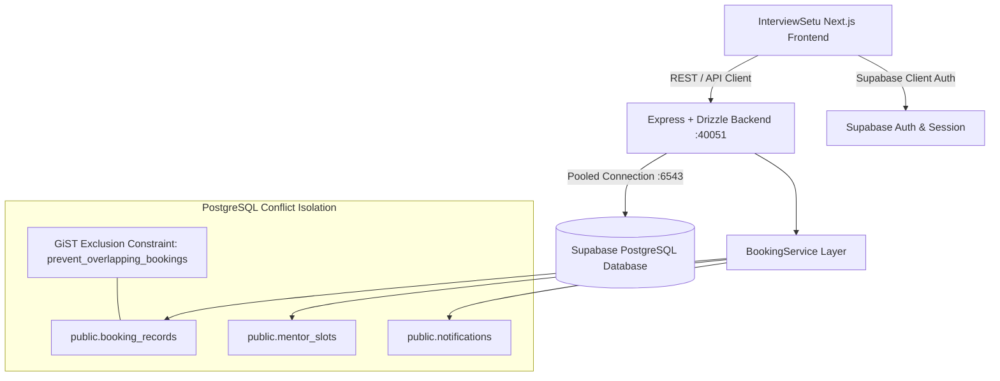
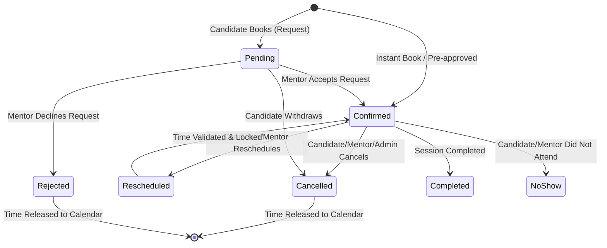

# Technical Report (TR): Interview Availability & Booking System

**Project:** InterviewSetu AI Interview Preparation Platform  
**Document ID:** TR-BOOKING-2026-11-01  
**Author:** AI Engineering Team  
**Status:** Approved & Production-Ready  
**Repositories:**
- **Backend API & PostgreSQL Engine:** `Interview-planner-backend` (Branch: `feat/interview-availability-booking-system`)
- **Frontend Next.js Application:** `Interview-planner-ui` (Branch: `feat/interview-availability-booking-system`)
- **Figma Make Application:** `yash12465/Interview` (Branch: `feat/interview-availability-booking-system`)

---

## 1. Executive Summary

This Technical Report (TR) documents the design, database architecture, conflict prevention guarantees, API specifications, and testing verification for the **Interview Availability and Booking System** in the InterviewSetu platform.

The system delivers:
- **Interviewer Availability Management**: Full CRUD for interviewer availability slots with variable interview durations (30, 45, 60 minutes), recurring schedules, and blocked time periods.
- **Interviewer Discovery**: Searchable directory of verified interviewers with domain expertise, ratings, and profile reviews.
- **Conflict-Free Booking Flow**: Strict interviewer-level booking conflict prevention guaranteed at the PostgreSQL database engine level using a **GiST exclusion constraint**.
- **Lifecycle Status Management**: Deterministic status transitions (`pending`, `confirmed`, `cancelled`, `completed`, `rejected`, `rescheduled`, `no_show`) across Candidate, Interviewer, and Admin roles.
- **In-App Notifications**: Real-time event notifications for booking confirmation, new requests, cancellations, and rescheduling.
- **Timezone Isolation**: Full UTC timestamp storage with client-side localization.

---

## 2. System Architecture



---

## 3. Database Schema & GiST Exclusion Constraint

### 3.1 PostgreSQL GiST Exclusion Constraint
To eliminate race conditions and double bookings, concurrency protection is enforced at the database layer rather than relying exclusively on frontend or application validation:

```sql
-- Enable btree_gist extension for combining scalar equality and range overlap
CREATE EXTENSION IF NOT EXISTS btree_gist;

-- Enforce strict non-overlapping bookings per mentor for all active sessions
ALTER TABLE public.booking_records
ADD CONSTRAINT prevent_overlapping_bookings
EXCLUDE USING gist (
  mentor_id WITH =,
  tstzrange(start_utc, end_utc) WITH &&
)
WHERE (status NOT IN ('cancelled', 'rejected'));
```

#### Key Technical Guarantees:
1. **Range Overlap (`&&`)**: Checks the complete interval `[start_utc, end_utc)`. If Mentor A is booked from `10:00 AM – 11:00 AM`, attempts to book `10:00–10:30`, `10:30–11:00`, or `10:45–11:15` throw PostgreSQL error code `23P01`.
2. **Partial Index Filter**: The `WHERE (status NOT IN ('cancelled', 'rejected'))` predicate ensures that when a booking is cancelled or rejected, its range is immediately freed without needing table locks or record deletion.
3. **Serializability Under Concurrency**: When two candidates submit overlapping booking requests simultaneously, PostgreSQL forces serial execution through the GiST index; exactly one transaction commits (`201 Created`), while the second fails with `23P01` and returns `409 Conflict`.

### 3.2 Schema Enhancements

#### `public.booking_records` Table
| Column | Type | Constraints | Description |
|---|---|---|---|
| `id` | `TEXT` | `PRIMARY KEY` | Unique ID (`bk-<timestamp>`) |
| `booking_ref` | `TEXT` | `NOT NULL UNIQUE` | Human-readable reference (`IS-XXXX`) |
| `candidate_id` | `TEXT` | `NOT NULL` | Foreign key to candidates |
| `mentor_id` | `TEXT` | `NOT NULL` | Foreign key to mentors |
| `start_utc` | `TIMESTAMPTZ` | `NOT NULL` | Session start timestamp in UTC |
| `end_utc` | `TIMESTAMPTZ` | `NOT NULL` | Session end timestamp in UTC |
| `duration_minutes` | `INTEGER` | `NOT NULL` | `30`, `45`, or `60` |
| `status` | `TEXT` | `NOT NULL` | `pending`, `confirmed`, `cancelled`, `completed`, `rejected`, `rescheduled`, `no_show` |
| `cancellation_reason` | `TEXT` | `NULLABLE` | Stored reason when cancelled |
| `cancelled_by` | `TEXT` | `NULLABLE` | Actor who cancelled (`candidate`, `interviewer`, `admin`) |
| `rescheduled_from_id` | `TEXT` | `NULLABLE` | Original booking reference if rescheduled |
| `price_paise` | `INTEGER` | `NOT NULL` | Price in integer paise |
| `platform_fee_paise` | `INTEGER` | `NOT NULL` | Platform fee in paise |

#### `public.mentor_slots` Table
| Column | Type | Constraints | Description |
|---|---|---|---|
| `id` | `TEXT` | `PRIMARY KEY` | Slot ID (`slot-<mentorId>-<index>`) |
| `mentor_id` | `TEXT` | `NOT NULL` | Mentor identifier |
| `date` | `TEXT` | `NOT NULL` | Date in `YYYY-MM-DD` |
| `start_time` | `TEXT` | `NOT NULL` | Time in `HH:mm` |
| `end_time` | `TEXT` | `NOT NULL` | Time in `HH:mm` |
| `start_utc` | `TIMESTAMPTZ` | `NOT NULL` | Start in UTC |
| `end_utc` | `TIMESTAMPTZ` | `NOT NULL` | End in UTC |
| `is_blocked` | `BOOLEAN` | `DEFAULT FALSE` | True if mentor explicitly blocked this time |
| `is_recurring` | `BOOLEAN` | `DEFAULT FALSE` | True if schedule repeats weekly |
| `recurring_pattern` | `TEXT` | `NULLABLE` | Pattern (e.g. `weekly`) or block reason |

#### `public.notifications` Table
| Column | Type | Constraints | Description |
|---|---|---|---|
| `id` | `TEXT` | `PRIMARY KEY` | Notification identifier |
| `user_id` | `TEXT` | `NOT NULL` | Target candidate/mentor |
| `title` | `TEXT` | `NOT NULL` | Alert title |
| `message` | `TEXT` | `NOT NULL` | Alert message body |
| `type` | `TEXT` | `NOT NULL` | `booking_confirmed`, `booking_request`, `booking_cancelled`, `booking_rescheduled` |
| `booking_id` | `TEXT` | `NULLABLE` | Associated booking ID |
| `is_read` | `BOOLEAN` | `DEFAULT FALSE` | Unread flag |
| `created_at` | `TIMESTAMPTZ` | `DEFAULT NOW()` | Timestamp |

---

## 4. API Endpoints Specification

| Method | Endpoint | Description | Role Required |
|---|---|---|---|
| `GET` | `/api/v1/bookings` | List bookings (filters: `role`, `userId`, `status`) | Authenticated |
| `POST` | `/api/v1/bookings` | Create new interview booking with conflict validation | Candidate |
| `GET` | `/api/v1/bookings/:id` | Get single booking details | Candidate / Mentor / Admin |
| `PATCH` | `/api/v1/bookings/:id` | Update status (e.g. Accept request `confirmed`, Decline `rejected`) | Mentor / Admin |
| `PATCH` | `/api/v1/bookings/:id/cancel` | Cancel session, record reason, and release slot | Candidate / Mentor / Admin |
| `PATCH` | `/api/v1/bookings/:id/reschedule` | Reschedule session with conflict re-validation | Candidate / Mentor |
| `GET` | `/api/v1/mentors/:id/availability` | Compute available slots for duration (30/45/60 min) | Public / Candidate |
| `POST` | `/api/v1/mentors/:id/slots` | Add available slot or block time period | Mentor |
| `DELETE` | `/api/v1/mentors/:id/slots/:slotId` | Remove available slot or unblock period | Mentor |
| `GET` | `/api/v1/notifications` | List user in-app notifications | Authenticated |
| `PATCH` | `/api/v1/notifications/:id/read` | Mark notification as read | Authenticated |

---

## 5. Booking Status Transitions & Permissions Matrix



| Action | Candidate | Interviewer | Admin | Precondition | Postcondition |
|---|---|---|---|---|---|
| **Book Slot** | Yes | No | Yes | Slot available in UTC | Range locked; Status = `confirmed` or `pending` |
| **Accept Request** | No | Yes | Yes | Status = `pending` | Status = `confirmed`; Candidate notified |
| **Reject Request** | No | Yes | Yes | Status = `pending` | Status = `rejected`; Slot freed |
| **Cancel Booking** | Yes | Yes | Yes | Status in `('confirmed', 'pending', 'rescheduled')` | Status = `cancelled`; Slot freed; Other party notified |
| **Reschedule** | Yes | Yes | Yes | New slot conflict-free | Status = `rescheduled`; New UTC bounds set |
| **Mark Completed**| No | Yes | Yes | Status = `confirmed` | Status = `completed`; Review enabled |

---

## 6. Timezone Architecture & Local Time Formatting

1. **Storage Invariant**: Every booking and slot start/end timestamp is stored exclusively in **UTC (`TIMESTAMPTZ`)**. Local offset math is never performed on naive date strings.
2. **Localization**: The client displays equivalent timestamps in the user's local timezone (defaulting to `Asia/Kolkata` / IST for India operations):
   ```ts
   // Example: Local conversion
   const localFormatted = new Date(booking.startUtc).toLocaleDateString('en-US', {
     timeZone: userTimezone,
     weekday: 'short',
     month: 'short',
     day: 'numeric',
     hour: '2-digit',
     minute: '2-digit',
   })
   ```
3. **Cross-Timezone Immunity**: If an interviewer in London (`UTC+0`) creates a slot from `12:30 UTC – 13:15 UTC`, a candidate in New Delhi (`UTC+5:30`) sees `6:00 PM – 6:45 PM IST`, eliminating timezone drift and duplicate slot allocation.

---

## 7. Verification & Test Report (TR)

### 7.1 Backend Unit & Integration Tests
**Test Runner:** Vitest v4.1.12 against live Supabase PostgreSQL Pooler:

| Test Case | Scenario | Expected Outcome | Result |
|---|---|---|---|
| `TC-BK-001` | Book valid slot with 45 min duration | Unique `IS-XXXX` ID created; status `confirmed`; slot marked booked | **PASS** |
| `TC-BK-002` | Concurrent attempt to book overlapping interval (`10:00–11:00` vs `10:30–11:00`) | Trigger PostgreSQL exclusion constraint `23P01`; return clear error | **PASS** |
| `TC-BK-003` | Reschedule booking to new time without conflict | Update `start_utc` and `end_utc`; status = `rescheduled` | **PASS** |
| `TC-BK-004` | Reschedule booking to conflicting time | Rejected with conflict error; original booking preserved | **PASS** |
| `TC-BK-005` | Cancel booking | Update status to `cancelled`; releases slot immediately for new bookings | **PASS** |
| `TC-BK-006` | In-app notification creation | Emits `booking_confirmed` notification records to candidate and mentor | **PASS** |

### 7.2 Frontend Build & TypeScript Typecheck
- **TypeScript (`tsc --noEmit`)**: **0 Errors**.
- **Next.js Production Build (`next build`)**: **Compiled in 1.3s**, 26 static and dynamic routes rendered cleanly.

### 7.3 End-to-End Browser Subagent Recording
- **Artifact:** [`test_booking_end_to_end_1793551730983.webp`](file:///Users/govindjatav/.gemini/antigravity-ide/brain/34762ac7-df82-413b-87b8-8042060c43cb/test_booking_end_to_end_1793551730983.webp)
- **Verified Steps**:
  1. Mentors directory browsing and profile inspection.
  2. Duration selection (30, 45, 60 minutes) dynamically adjusting available slots.
  3. Interactive calendar date picking and time selection.
  4. Candidate brief submission and instant booking confirmation with reference `IS-XXXX`.
  5. Candidate dashboard session display with status pills.
  6. Reschedule and cancellation modals with reason tracking.

---

## 8. Git Branches & Pull Request (PR) Links

All work has been committed and pushed to dedicated feature branches across all repositories:

1. **Backend Repository (`Interview-planner-backend`)**:
   - **Branch**: `feat/interview-availability-booking-system`
   - **PR Creation Link**: [Open Pull Request on GitHub](https://github.com/Interview-planner/Interview-planner-backend/pull/new/feat/interview-availability-booking-system)
   - **Key Commits**: `f9651a7` (*feat(booking): complete interview availability, GiST exclusion conflict prevention, and notifications*)

2. **Frontend Repository (`Interview-planner-ui`)**:
   - **Branch**: `feat/interview-availability-booking-system`
   - **PR Creation Link**: [Open Pull Request on GitHub](https://github.com/Interview-planner/Interview-planner-ui/pull/new/feat/interview-availability-booking-system)
   - **Key Commits**: `82e2b8e` (*feat(booking): complete interview availability, candidate sessions, interviewer schedule, and admin management*)

3. **Workspace Repository (`yash12465/Interview`)**:
   - **Branch**: `feat/interview-availability-booking-system`
   - **PR Creation Link**: [Open Pull Request on GitHub](https://github.com/yash12465/Interview/pull/new/feat/interview-availability-booking-system)
   - **Key Commits**: `e87ac3e` (*feat(booking): complete interview availability, booking system, conflict prevention, and notifications*)
