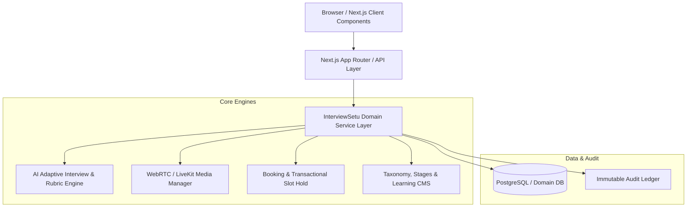

# InterviewSetu Architecture & System Design

## 1. Overview
InterviewSetu is a unified, full-stack interview preparation and marketplace platform providing:
- **Role A (Candidate / Interviewee):** AI mock interviews (adaptive voice & text), rubric scorecards, learning academy, answer lab, and 1:1 mentor booking.
- **Role B (Interviewer / Mentor):** Application verification workflow, availability calendar, WebRTC live interview room, post-session structured scorecards, and earnings ledger.
- **Role C (Platform Admin / Operator):** User management, interviewer evidence verification, official exam & stage taxonomy builder, question bank CMS, AI prompt governance, and immutable audit logging.

---

## 2. System Architecture Diagram

---

## 3. Technology Stack
- **Framework:** Next.js App Router (v16.4.2) with React 19 and TypeScript.
- **Styling:** Tailwind CSS v4 with custom Signal & Flow liquid aurora design system, water-ripple physics, and responsive breakpoints (320px–1440px).
- **Backend & APIs:** Next.js Route Handlers with REST JSON under `/api/v1/*`.
- **Media & Voice:** WebRTC / Web Speech API / LiveKit tokens for real-time video/audio rooms.
- **Data Persistence:** Domain data service layer with relational schemas, strong typing, and deterministic test adapters.

---

## 4. Route Map & Permissions

| Route | Role | Description |
|---|---|---|
| `/` | Public | Homepage with liquid aurora, floating constellation, sticky category explorer, 1:1 guidance, waveform, FAQ |
| `/interview-tracks` | Public | Catalogue of verified interview preparation tracks and stages |
| `/interview-tracks/[slug]` | Public | Official selection stages, competencies, and track-specific mentors |
| `/exams` & `/exams/[slug]` | Public | Official examination notifications and interview applicability |
| `/learn` & `/learn/[slug]` | Public / Candidate | Learning academy courses, interactive framework lessons, knowledge check quizzes |
| `/question-bank` | Public / Candidate | Question bank with intent, frameworks, and practice retry |
| `/mentors` & `/mentors/[slug]` | Public / Candidate | Mentor marketplace directory, verification badges, booking flow |
| `/pricing` | Public | Transparent subscription tiers & pay-as-you-go mentor rates |
| `/login` & `/register` | Public | Unified authentication & role selection |
| `/onboarding/candidate` | Candidate | 6-step onboarding wizard |
| `/onboarding/interviewer` | Interviewer | Multi-step credential & verification evidence upload |
| `/app/candidate` | Candidate | Candidate workspace, AI interview studio, scorecards, progress analytics |
| `/app/interviewer` | Interviewer | Interviewer workspace, booking requests, live video room, scorecard submission |
| `/app/admin` & `/staff` | Admin | Operations dashboard, application review queue, audit logs, AI governance |
